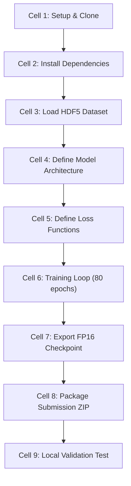

# Report 4: Final Best Kaggle End-to-End Pipeline

**Goal**: Train a CLIP ViT-L/14 based model with natural language attribute templates to achieve ≥0.66 mADM on CodaBench server.
**Hardware**: Kaggle Dual Tesla T4 (14.5GB VRAM each, 30GB RAM, 4 CPU cores)
**Session Limit**: 12 hours
**Target**: Complete training + export + ZIP packaging in one session

---

## 1. Notebook Architecture Overview



---

## 2. Cell-by-Cell Specification

### Cell 1: Environment Setup & Repository Clone
```python
!nvidia-smi
import torch
print(f"CUDA: {torch.cuda.is_available()}, GPUs: {torch.cuda.device_count()}")

# Clone repository
import os
from kaggle_secrets import UserSecretsClient
token = UserSecretsClient().get_secret("GITHUB_TOKEN")
!git clone https://{token}@github.com/Aditya-Lingam-9000/upar_challenge_26_rws27.git /kaggle/working/repo
os.chdir('/kaggle/working/repo')
```

### Cell 2: Install Dependencies
```python
!pip install -q open_clip_torch timm accelerate
```

> [!NOTE]
> `open_clip_torch` provides CLIP ViT-L/14 weights. At inference time on CodaBench, we load weights from the saved checkpoint (no internet needed).

### Cell 3: Load HDF5 Dataset
```python
import h5py
import numpy as np
from torch.utils.data import Dataset, DataLoader
from PIL import Image
import io

H5_PATH = "/kaggle/input/datasets/hinewk/upar-binary-dataset/upar_binary_dataset.h5"

class UPARDataset(Dataset):
    def __init__(self, h5_path, split='train', transform=None):
        self.h5 = h5py.File(h5_path, 'r')
        self.split = split
        self.transform = transform
        self.images = self.h5[f'{split}/images']
        self.labels = self.h5[f'{split}/labels'][:]  # (N, 40) binary
        self.length = len(self.labels)
        
    def __len__(self):
        return self.length
    
    def __getitem__(self, idx):
        img_bytes = self.images[idx]
        img = Image.open(io.BytesIO(img_bytes)).convert('RGB')
        if self.transform:
            img = self.transform(img)
        labels = torch.from_numpy(self.labels[idx]).float()
        
        # Generate text description from attributes
        text = attrs_to_text(self.labels[idx])
        return img, labels, text

print(f"Train: {len(UPARDataset(H5_PATH, 'train'))} images")
print(f"Val: {len(UPARDataset(H5_PATH, 'val'))} images")
```

### Cell 4: Model Architecture

**Two approaches depending on ZIP size constraints**:

#### Approach A: CLIP ViT-L/14 with Text Encoder (Best Quality, ~580MB)

```python
import open_clip

class CLIPRetrievalModel(nn.Module):
    def __init__(self, num_attrs=40, embed_dim=512):
        super().__init__()
        # Load CLIP ViT-L/14
        self.clip_model, _, self.preprocess = open_clip.create_model_and_transforms(
            'ViT-L-14', pretrained='openai'
        )
        self.tokenizer = open_clip.get_tokenizer('ViT-L-14')
        
        # Visual projection (1024 -> embed_dim)
        self.visual_proj = nn.Sequential(
            nn.Linear(1024, embed_dim),
            nn.LayerNorm(embed_dim),
        )
        
        # Multi-label attribute head  
        self.attr_head = nn.Sequential(
            nn.Linear(1024, 512),
            nn.ReLU(),
            nn.Dropout(0.2),
            nn.Linear(512, num_attrs),
        )
        
        self.embed_dim = embed_dim
        
    def encode_image(self, images):
        """Extract visual features."""
        features = self.clip_model.encode_image(images)  # (B, 1024)
        embed = F.normalize(self.visual_proj(features), p=2, dim=-1)
        logits = self.attr_head(features)
        return embed, logits
    
    def encode_text(self, texts):
        """Encode text descriptions using CLIP text encoder."""
        tokens = self.tokenizer(texts).to(next(self.parameters()).device)
        features = self.clip_model.encode_text(tokens)  # (B, 1024)
        embed = F.normalize(self.visual_proj(features), p=2, dim=-1)
        return embed
```

#### Approach B: Swin-Base Pure Attribute Classifier (Safer, ~200MB)

```python
import timm

class SwinAttributeModel(nn.Module):
    def __init__(self, num_attrs=40, embed_dim=512):
        super().__init__()
        self.backbone = timm.create_model('swin_base_patch4_window7_224', pretrained=True)
        self.backbone.head = nn.Identity()
        
        self.attr_head = nn.Sequential(
            nn.Linear(1024, 512),
            nn.BatchNorm1d(512),
            nn.ReLU(),
            nn.Dropout(0.2),
            nn.Linear(512, num_attrs),
        )
        
        self.metric_head = nn.Sequential(
            nn.Linear(1024, embed_dim),
            nn.LayerNorm(embed_dim),
        )
        
    def forward(self, images):
        features = self.backbone(images)
        logits = self.attr_head(features)
        embed = F.normalize(self.metric_head(features), p=2, dim=-1)
        return embed, logits
```

### Cell 5: Loss Functions

```python
class AsymmetricLoss(nn.Module):
    """Multi-label Asymmetric Loss for handling severe class imbalance."""
    def __init__(self, gamma_neg=4, gamma_pos=0, clip=0.05):
        super().__init__()
        self.gamma_neg = gamma_neg
        self.gamma_pos = gamma_pos
        self.clip = clip
        
    def forward(self, logits, targets):
        xs_pos = torch.sigmoid(logits)
        xs_neg = 1.0 - xs_pos
        
        # Asymmetric Clipping
        if self.clip > 0:
            xs_neg = (xs_neg + self.clip).clamp(max=1)
        
        # Basic CE
        los_pos = targets * torch.log(xs_pos.clamp(min=1e-8))
        los_neg = (1 - targets) * torch.log(xs_neg.clamp(min=1e-8))
        
        # Asymmetric Focusing
        if self.gamma_neg > 0 or self.gamma_pos > 0:
            pt0 = xs_pos * targets
            pt1 = xs_neg * (1 - targets)
            pt = pt0 + pt1
            one_sided_gamma = self.gamma_pos * targets + self.gamma_neg * (1 - targets)
            one_sided_w = torch.pow(1 - pt, one_sided_gamma)
            loss = -one_sided_w * (los_pos + los_neg)
        else:
            loss = -(los_pos + los_neg)
        
        return loss.mean()


class SDMLoss(nn.Module):
    """Similarity Distribution Matching loss from IRRA (CVPR 2023)."""
    def __init__(self, temperature=0.05):
        super().__init__()
        self.temperature = temperature
        
    def forward(self, image_embeds, text_embeds):
        # Compute similarity matrices
        sim_i2t = image_embeds @ text_embeds.T / self.temperature
        sim_t2i = text_embeds @ image_embeds.T / self.temperature
        
        # Soft targets: each image matches texts with similar attributes
        targets = F.softmax(sim_i2t.detach(), dim=1)
        
        # KL divergence
        loss_i2t = F.kl_div(F.log_softmax(sim_i2t, dim=1), targets, reduction='batchmean')
        loss_t2i = F.kl_div(F.log_softmax(sim_t2i, dim=1), targets.T, reduction='batchmean')
        
        return (loss_i2t + loss_t2i) / 2
```

### Cell 6: Training Loop

```python
from accelerate import Accelerator

accelerator = Accelerator(mixed_precision='fp16', gradient_accumulation_steps=2)

model = CLIPRetrievalModel()  # or SwinAttributeModel()
optimizer = torch.optim.AdamW([
    {'params': model.clip_model.parameters(), 'lr': 5e-6, 'weight_decay': 0.05},
    {'params': model.visual_proj.parameters(), 'lr': 5e-4},
    {'params': model.attr_head.parameters(), 'lr': 5e-4},
], betas=(0.9, 0.999))

scheduler = torch.optim.lr_scheduler.CosineAnnealingLR(optimizer, T_max=80, eta_min=1e-7)

asl_loss = AsymmetricLoss(gamma_neg=4, gamma_pos=0, clip=0.05)
sdm_loss = SDMLoss(temperature=0.05)

# Prepare with Accelerate
model, optimizer, train_loader, val_loader, scheduler = accelerator.prepare(
    model, optimizer, train_loader, val_loader, scheduler
)

best_madm = 0.0
for epoch in range(80):
    model.train()
    for batch_idx, (images, labels, texts) in enumerate(train_loader):
        with accelerator.accumulate(model):
            img_embeds, attr_logits = model.encode_image(images)
            text_embeds = model.encode_text(texts)
            
            loss_attr = asl_loss(attr_logits, labels)
            loss_sdm = sdm_loss(img_embeds, text_embeds)
            loss_itc = F.cross_entropy(
                img_embeds @ text_embeds.T / 0.05,
                torch.arange(len(images), device=images.device)
            )
            
            total_loss = 1.0 * loss_attr + 0.5 * loss_sdm + 0.3 * loss_itc
            
            accelerator.backward(total_loss)
            optimizer.step()
            optimizer.zero_grad()
    
    scheduler.step()
    
    # Validation every 5 epochs
    if (epoch + 1) % 5 == 0:
        madm = evaluate(model, val_loader)
        if madm > best_madm:
            best_madm = madm
            accelerator.save_state(f'best_checkpoint')
            print(f"Epoch {epoch+1}: New best mADM = {madm:.4f}")

    # Save resumable checkpoint every 10 epochs
    if (epoch + 1) % 10 == 0:
        torch.save({
            'epoch': epoch,
            'model_state_dict': accelerator.unwrap_model(model).state_dict(),
            'optimizer_state_dict': optimizer.state_dict(),
            'scheduler_state_dict': scheduler.state_dict(),
            'best_madm': best_madm,
        }, f'checkpoint_epoch_{epoch+1}.pt')
```

### Cell 7: Export FP16 Checkpoint
```python
# Load best model
model_unwrapped = accelerator.unwrap_model(model)
model_unwrapped.eval()

# Convert to FP16
state_dict = {k: v.half() for k, v in model_unwrapped.state_dict().items()}
torch.save({'model_state_dict': state_dict}, 'model_final_fp16.pt')

import os
size_mb = os.path.getsize('model_final_fp16.pt') / 1e6
print(f"Model size: {size_mb:.1f} MB")
assert size_mb < 480, f"Model too large for submission: {size_mb:.1f} MB"
```

### Cell 8: Package Submission ZIP
```python
import zipfile
import shutil

# Create submission directory
os.makedirs('submission/assets', exist_ok=True)

# Copy model weights
shutil.copy('model_final_fp16.pt', 'submission/assets/')

# Copy run.py (NEW inference entrypoint)
shutil.copy('sota_pipeline/submission_template_v4/run.py', 'submission/')

# Vendor timm (required, no internet on CodaBench)
shutil.copytree('venv/lib/python3.11/site-packages/timm', 'submission/vendor/timm',
                dirs_exist_ok=True)

# Create ZIP
with zipfile.ZipFile('submission_v4.zip', 'w', zipfile.ZIP_DEFLATED) as zf:
    for root, dirs, files in os.walk('submission'):
        for f in files:
            filepath = os.path.join(root, f)
            arcname = os.path.relpath(filepath, 'submission')
            zf.write(filepath, arcname)

zip_size = os.path.getsize('submission_v4.zip') / 1e6
print(f"Submission ZIP: {zip_size:.1f} MB")
assert zip_size < 500, f"ZIP too large: {zip_size:.1f} MB"
```

### Cell 9: Push to GitHub & Download
```python
!git add -A
!git commit -m "feat: CLIP ViT-L/14 model v4"
!git push

# Also upload to Kaggle output for download
shutil.copy('submission_v4.zip', '/kaggle/working/')
```

---

## 3. Inference Pipeline for run.py (V4)

The new `run.py` must:

1. **Load CLIP ViT-L/14 from checkpoint** (no internet, pure PyTorch)
2. **Extract gallery features** with Horizontal Flip TTA
3. **Predict gallery attributes** from auxiliary head
4. **Calibrate attributes** with Prior-Matching (Newton-Raphson)
5. **Convert query attributes to text** using template
6. **Encode text queries** using CLIP text encoder
7. **Compute dual similarity**: α=0.70 attribute + 0.30 metric
8. **Apply k-reciprocal reranking** (if time permits)

**Key Difference from V3**: Query encoding uses CLIP text encoder on natural language instead of MLP on binary vector.

---

## 4. Expected Timeline & Metrics

| Milestone | Time | Expected Score |
|-----------|------|----------------|
| Training starts | T+0h | — |
| Epoch 20 | T+2h | ~0.60 local mADM |
| Epoch 40 | T+4h | ~0.70 local mADM |
| Epoch 60 | T+6h | ~0.78 local mADM |
| Epoch 80 | T+8h | ~0.82+ local mADM |
| Export + ZIP | T+9h | — |
| **Server submission** | T+10h | **0.64-0.68 mADM** |

> [!WARNING]
> **Local vs Server Gap**: Based on 11 submissions, our local-to-server ratio is ~75% (e.g., 0.75 local → 0.57 server). This is due to domain shift (unseen MEVID surveillance cameras). The surveillance degradation augmentation in training should reduce this gap.

---

## 5. Fallback Plan

If CLIP ViT-L/14 exceeds 500MB ZIP limit:
1. **Option 1**: Use CLIP ViT-B/16 (164MB FP16) — fits easily, but weaker
2. **Option 2**: Quantize ViT-L/14 to INT8 (~290MB) — may lose 0.01-0.02 mADM
3. **Option 3**: Use Swin-Base pure attribute classifier (168MB) — safe, proven

If training doesn't converge in 12 hours:
1. Save checkpoint at best epoch
2. Resume in next Kaggle session
3. Use best available checkpoint for submission
