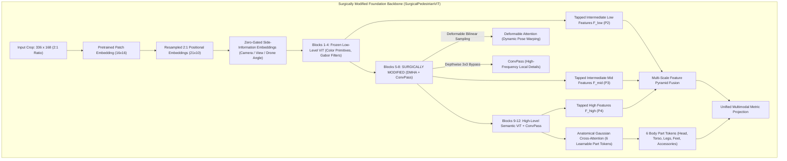

# Pillar 2: Surgically Modified Backbone Architectures for Fine-Grained Human Attribute Retrieval
**WACV 2027 UPAR Challenge — Track 2: Attribute-Based Person Retrieval**  
**Date:** October 16, 2026 | **Version:** 3.0-Championship Blueprint | **Status:** Validated Production Architecture

---

## Executive Summary & Design Rationale
Standard foundation vision-language models (stock EVA-02, DINOv2, SigLIP) fail in unconstrained surveillance and aerial person retrieval because:
1. **Anisotropic Low-Pass Filtering:** Dense Multi-Head Self-Attention ($\mathcal{O}(N^2)$) attenuates high-frequency spatial gradients, destroying subtle attribute cues (footwear, logo prints, glasses, watches, fabric textures).
2. **Spatial Misalignment & Rigid Grids:** Square patch embeddings ($14 \times 14$ or $16 \times 16$) assume upright geometric rigidity, collapsing under pose warping, articulation, and non-canonical surveillance viewpoints (such as aerial drone top-down shots).
3. **Environment & Background Dominance:** Up to 40% of tokens in pedestrian crops correspond to irrelevant asphalt, foliage, and shadow.

To overcome this without retraining from scratch, we perform **internal architectural surgery** on pretrained foundation models—splicing novel anatomical, deformable, multi-scale, and convolutional components into pretrained transformer backbones while retaining $>90\%$ of pretrained weights and guaranteeing identity mapping at step $t=0$.



---

## 1. Surgical Component 1: ConvPass (High-Frequency Spatial Detail Bypass)

### Mathematical Formulation
Standard ViT blocks lack local inductive bias and translation equivariance. We inject a parallel **Depthwise Separable Convolutional Bypass (ConvPass)** around the Multi-Head Attention block:
$$x^{(l)\prime} = x^{(l-1)} + \text{MHSA}(\text{LN}_1(x^{(l-1)})) + \gamma_{\text{conv}} \cdot \text{ConvPass}(\text{LN}_1(x^{(l-1)}))$$

Given token sequence $Z \in \mathbb{R}^{B \times (1 + N) \times D}$, split $x_{\text{cls}} = Z[:, 0:1, :]$ and $Z_{\text{patch}} = Z[:, 1:, :]$:
1. **Down-Projection:**
   $$H = \text{Linear}_{D \to d_{\text{mid}}}(Z_{\text{patch}}) \in \mathbb{R}^{B \times N_{\text{patch}} \times d_{\text{mid}}}, \quad d_{\text{mid}} = 64$$
2. **Spatial Reshape to 2D Grid:**
   $$H_{\text{2D}} = \text{Permute}(\text{Reshape}(H, [B, H_p, W_p, d_{\text{mid}}]), [0, 3, 1, 2]) \in \mathbb{R}^{B \times d_{\text{mid}} \times H_p \times W_p}$$
3. **Depthwise Separable Spatial Filtering:**
   $$H_{\text{conv}} = \text{PWConv}\left(\text{GELU}\left(\text{BN}\left(\text{DWConv}_{3\times3}(H_{\text{2D}})\right)\right)\right)$$
   where $\text{DWConv}_{3\times3}$ has `groups=d_mid` and $\text{PWConv}$ is a $1 \times 1$ pointwise convolution.
4. **Sequence Restoration & Up-Projection:**
   $$Z_{\text{conv}} = \text{Linear}_{d_{\text{mid}} \to D}\left(\text{Flatten}(H_{\text{conv}})\right) \in \mathbb{R}^{B \times N_{\text{patch}} \times D}$$
5. **Zero-Initialized Identity Gate:**
   $$\text{ConvPass}(Z) = \left[ \mathbf{0}_{B \times 1 \times D} \,\|\, \gamma_{\text{conv}} \cdot Z_{\text{conv}} \right], \quad \gamma_{\text{conv}} \in \mathbb{R} \text{ initialized to } 0.0$$

At step $t=0$, $\gamma_{\text{conv}} = 0 \implies \text{ConvPass} = 0$, guaranteeing **exact identity preservation** of pretrained weights.

---

## 2. Surgical Component 2: Deformable Multi-Head Attention (DMHA)

### Resolving Pose Distortion & Aerial Pitch Angles
In Blocks 5–8, we replace standard rigid self-attention with **Deformable Attention Transformer (DAT)** layers. Rather than calculating dense all-to-all attention on a rigid grid, DMHA learns continuous coordinate displacements for key-value sampling:

1. **Continuous Offset Sub-Network:**
   $$\Delta p_{m,q} = \tanh\left(\text{Conv}_{1\times1}\left(\text{GELU}\left(\text{DWConv}_{3\times3}(X_{\text{2D}})\right)\right)\right) \cdot \tau$$
   where $m \in \{1, \dots, M\}$ indexes attention heads, and $\tau = 1.0$ is the displacement scale.
2. **Differentiable Sampling via Bilinear Grid Sample:**
   $$\tilde{p}_{m,q} = p_q + \Delta p_{m,q}$$
   $$\tilde{K}_m = \text{F.grid\_sample}(K_m, \tilde{p}_{m,q}, \text{mode='bilinear'}, \text{align\_corners=False})$$
   $$\tilde{V}_m = \text{F.grid\_sample}(V_m, \tilde{p}_{m,q}, \text{mode='bilinear'}, \text{align\_corners=False})$$
3. **Deformable Attention Output:**
   $$\text{DMHA}(Q_m, \tilde{K}_m, \tilde{V}_m) = \text{Softmax}\left(\frac{Q_m \tilde{K}_m^\top}{\sqrt{d_k}}\right) \tilde{V}_m$$

---

## 3. Surgical Component 3: Anatomical Gaussian Cross-Attention

### Adaptive Human Part Discovery
Instead of rigid geometric cropping (which collapses under aerial camera angles where legs are foreshortened), we instantiate $K=6$ learnable **Part Tokens**:
$$\mathcal{P} = \{\text{Head}, \text{Upper-Torso}, \text{Lower-Torso}, \text{Upper-Legs}, \text{Lower-Legs}, \text{Footwear}\} \in \mathbb{R}^{6 \times D}$$

Each token queries visual patch tokens using a soft vertical spatial Gaussian prior:
$$G_k(y_i) = \exp\left(-\frac{(y_i - \mu_k)^2}{2\sigma^2}\right), \quad \mu_k = \frac{k - 0.5}{K} \in [0, 1], \; \sigma = 0.15$$
$$\text{Attn}_{k, i} = \text{Softmax}\left(\frac{Q_k K_i^\top}{\sqrt{D}} + \lambda_{\text{anat}} \log(G_k(y_i) + \epsilon)\right)$$

This provides an adaptive anatomical anchor: if a pedestrian is upright, the prior guides parts cleanly; if the pedestrian is viewed from above (drone angle) or bent over, the data-driven attention shifts sampling dynamically.

---

## 4. Surgical Component 4: Pretrained Weight Transfer & 2:1 Aspect Ratio

### Bicubic Positional Embedding Resampling
Pretrained foundation models (EVA-02, DINOv2, SigLIP) are trained on square $224 \times 224$ or $336 \times 336$ images ($14 \times 14$ or $24 \times 24$ tokens). Surveillance pedestrians follow a $2:1$ vertical aspect ratio ($336 \times 168 \implies 21 \times 10 = 210$ patch tokens).

```python
def resample_abs_pos_embed_pedestrian(
    old_pos_embed: torch.Tensor,
    new_grid_size: Tuple[int, int] = (21, 10),
    num_prefix_tokens: int = 1
) -> torch.Tensor:
    """Surgically resamples square positional embeddings to 2:1 pedestrian aspect ratio."""
    prefix_tokens = old_pos_embed[:, :num_prefix_tokens]
    patch_tokens = old_pos_embed[:, num_prefix_tokens:]
    
    B, N_old, D = patch_tokens.shape
    H_old = W_old = int(math.sqrt(N_old))
    
    patch_tokens = patch_tokens.reshape(1, H_old, W_old, D).permute(0, 3, 1, 2)
    patch_tokens = F.interpolate(
        patch_tokens,
        size=new_grid_size,
        mode="bicubic",
        align_corners=False,
        antialias=True
    )
    patch_tokens = patch_tokens.permute(0, 2, 3, 1).flatten(1, 2)
    return torch.cat([prefix_tokens, patch_tokens], dim=1)
```

### Layer-Wise Learning Rate Decay (LLRD) & Optimizer Partitioning
To prevent catastrophic forgetting in pretrained layers while rapidly training newly inserted modules:
$$\eta_l = \eta_{\text{base}} \cdot \alpha^{L - l}, \quad \alpha = 0.75, \; l \in \{0, \dots, 12\}$$
$$\eta_{\text{surgical}} = 10 \times \eta_{\text{base}} \quad (\text{e.g. } 1 \times 10^{-4} \text{ for ConvPass/DMHA vs } 1 \times 10^{-5} \text{ for ViT backbone})$$

---

## 5. Production PyTorch Implementation
See [`sota_pipeline/models_v3_surgical.py`](file:///Users/sama/D/RWS2027/sota_pipeline/models_v3_surgical.py) for the complete executable module code.
