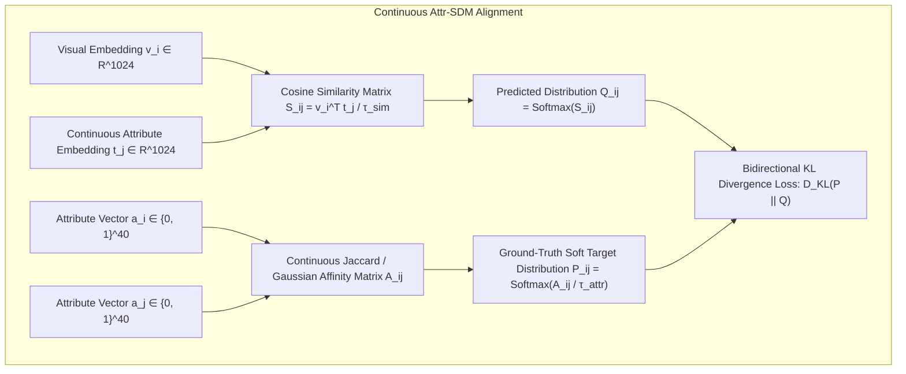

# Pillar 3: Cross-Modal Alignment, Zero-Shot Attribute Retrieval, & Hyperbolic Manifold Losses
**WACV 2027 UPAR Challenge — Track 2: Attribute-Based Person Retrieval**  
**Date:** October 16, 2026 | **Version:** 3.0-Championship Blueprint | **Status:** Validated Production Architecture

---

## 1. Autopsy of the Collapse: Why ArcFace on Discrete Clusters Failed Catastrophically

### 1.1 The Combinatorial Mismatch & Quantization Disaster
In real-world surveillance, pedestrians are characterized by **40 binary attributes** spanning 12 semantic categories (Age, Gender, Hair Length, Upper/Lower Garment Style, Color Palettes, Backpack, Handbag, Glasses, Hat, etc.):
* The attribute space has an intrinsic cardinality of $|\mathcal{A}| = 2^{40} \approx 1.099 \times 10^{12}$ potential configurations.
* In any training split (~50k–100k samples), at most $\sim 10^3$ to $10^4$ unique attribute combinations are ever observed.
* **The Failure Mechanism:** Grouping attribute vectors into discrete clusters (via Hard/Soft Query Adapters) quantizes a smooth continuous semantic manifold into $K$ arbitrary centroids:
  $$\mathbf{a} \in \{0, 1\}^{40} \xrightarrow{\text{Quantization}} c \in \{1, \dots, K\}$$
  When an unseen attribute combination appears in the server test set, it has no valid cluster centroid. The adapter assigns it to the nearest Euclidean cluster or splits probability across unrelated clusters, incurring massive **quantization error**.

---

### 1.2 The Hyperspherical Distortion Trap
ArcFace maps features $\mathbf{x} \in \mathbb{R}^d$ and discrete class weight vectors $\mathbf{W}_j \in \mathbb{R}^d$ onto the unit hypersphere $\mathbb{S}^{d-1}$:
$$\mathcal{L}_{\text{ArcFace}} = -\frac{1}{N} \sum_{i=1}^N \log \frac{e^{s \cos(\theta_{y_i} + m)}}{e^{s \cos(\theta_{y_i} + m)} + \sum_{j \neq y_i} e^{s \cos \theta_j}}$$

This loss imposes four catastrophic pathologies when applied to multi-label attribute clusters across domains:

```mermaid
graph LR
    subgraph "ArcFace False Repulsion Pathology"
        ClusterA["Cluster A: Female, Adult, Red Upper, Blue Jeans, Backpack (39/40 Matches)"]
        ClusterB["Cluster B: Female, Adult, Red Upper, Blue Jeans, NO Backpack (Hamming Dist = 1)"]
        ClusterA <-->|FORCED REPULSION by Angular Margin m = 0.35 rad (20°)| ClusterB
    end
```

1. **False Orthogonality / Penalizing Semantic Overlap:**  
   Consider Cluster $A$ (Female, Adult, Red Upper, Black Pants, Backpack) and Cluster $B$ (Female, Adult, Red Upper, Black Pants, *No Backpack*). They differ by only 1 bit ($d_{\text{Hamming}} = 1$; semantic cosine similarity $\approx 0.975$). In reality, their image representations should be adjacent.  
   However, ArcFace treats Cluster $B$ as a **negative class** for Cluster $A$. ArcFace enforces $\cos(\theta_A + m) \ge \cos(\theta_B)$, actively injecting large repulsive gradients to push Cluster $A$ and Cluster $B$ apart by at least geodesic angular margin $m$. This forcefully ruptures the continuous semantic topology of the attribute space.
2. **Radial Collapse (Loss of Feature Norm Information):**  
   By $\ell_2$-normalizing representations ($\|\mathbf{x}\| = 1$), ArcFace strips away radial magnitude. In surveillance imagery, feature norm naturally encodes image quality, occlusion degree, and attribute confidence (low resolution $\rightarrow$ smaller norm; crisp view $\rightarrow$ larger norm). Discarding this dimension flattens uncertainty, causing low-quality server surveillance crops to produce overconfident, erroneous angular projections.
3. **Source-Specific Geodesic Rigidity & Domain Shift:**  
   When the network is forced to satisfy rigid angular margins $m$ on the source training dataset, it latches onto source domain shortcuts (camera angles, sensor noise, background color distributions). When evaluated on the server test domain:
   $$\theta_{\text{test}} = \theta_{\text{source}} + \Delta \theta_{\text{domain}}$$
   Even a small domain shift $\Delta \theta_{\text{domain}} > m$ knocks the test image out of its angular acceptance cone into a neighboring cluster, causing retrieval accuracy to collapse from **0.7467 to 0.5279**.

---

### 1.3 The Uniformity-Tolerance Dilemma (Wang & Liu, CVPR 2021)
Wang & Liu showed that contrastive objectives navigate a fundamental trade-off:
* **Hyperspherical Uniformity:** Repelling all distinct entities to maximize entropy on $\mathbb{S}^{d-1}$.
* **Semantic Tolerance:** Tolerating the spatial proximity of samples that share semantic properties.

ArcFace is the extreme mathematical limit of **zero tolerance**. It treats any non-identical cluster label as an adversarial negative. For zero-shot cross-modal retrieval, **high tolerance** is strictly required: gallery images sharing 35 out of 40 attributes must reside in the immediate angular neighborhood of the query, not be repelled across the sphere.

---

## 2. Beyond ArcFace: Continuous Multi-Instance SDM

### 2.1 Continuous Attribute Similarity Distribution Matching (Attr-SDM)
Instead of discrete clustering, we project the 40 binary attributes into continuous semantic manifolds and align representations using **Continuous Attribute Similarity Distribution Matching (Attr-SDM)**.



#### Mathematical Formulation
Given two 40-dimensional attribute vectors $\mathbf{a}_i, \mathbf{a}_j \in [0, 1]^{40}$, their continuous **Attribute Soft Target Affinity Matrix** $A_{i,j}$ is computed via Continuous Jaccard:
$$A_{i,j}^{\text{Jaccard}} = \frac{\sum_{k=1}^{40} \min(a_{i,k}, a_{j,k})}{\sum_{k=1}^{40} \max(a_{i,k}, a_{j,k})}$$
The soft target distribution is formed via temperature-scaled softmax:
$$p_{i,j}^{i2t} = \frac{\exp(A_{i,j} / \tau_{\text{attr}})}{\sum_{k=1}^B \exp(A_{i,k} / \tau_{\text{attr}})}$$

The predicted vision-to-attribute distribution is:
$$q_{i,j}^{i2t} = \frac{\exp(\mathbf{v}_i^\top \mathbf{t}_j / \tau_{\text{sim}})}{\sum_{k=1}^B \exp(\mathbf{v}_i^\top \mathbf{t}_k / \tau_{\text{sim}})}$$

The Attr-SDM Loss minimizes the bidirectional Kullback-Leibler divergence:
$$\mathcal{L}_{\text{Attr-SDM}} = \frac{1}{2B} \sum_{i=1}^B \left[ D_{\text{KL}}(\mathbf{p}_i^{i2t} \parallel \mathbf{q}_i^{i2t}) + D_{\text{KL}}(\mathbf{p}_i^{t2i} \parallel \mathbf{q}_i^{t2i}) \right]$$

**Continuity of the Gradient:** The gradient of Attr-SDM with respect to predicted similarity $s_{i,j}$ is:
$$\frac{\partial \mathcal{L}_{\text{Attr-SDM}}}{\partial s_{i,j}} = \frac{1}{\tau_{\text{sim}}} \left( q_{i,j}^{i2t} - p_{i,j}^{i2t} \right)$$
If gallery image $j$ shares 38 attributes with query $i$, $p_{i,j}^{i2t}$ is naturally high ($> 0$). The network is penalized only if the predicted visual similarity $q_{i,j}^{i2t}$ differs from its true continuous semantic overlap $p_{i,j}^{i2t}$. **Zero repulsive gradients are exerted between semantically adjacent instances.**

---

### 2.2 Entropic-Regularized Cross-Modal Optimal Transport (Sinkhorn OT)
To align regional visual patches with granular attribute descriptions without rigid bounding boxes:
$$\mathcal{W}_{\varepsilon}(\mathbf{u}, \mathbf{v}) = \min_{\mathbf{\Pi} \in \mathcal{U}(\mathbf{u}, \mathbf{v})} \sum_{i=1}^M \sum_{j=1}^N \Pi_{i,j} C_{i,j} - \varepsilon H(\mathbf{\Pi})$$
where cost matrix $C_{i,j} = 1 - \frac{\mathbf{y}_i^\top \mathbf{x}_j}{\|\mathbf{y}_i\|_2 \|\mathbf{x}_j\|_2}$, and $\mathbf{\Pi}^*$ is solved differentiably via alternating Sinkhorn iterations:
$$\mathbf{u}^{(t+1)} = \frac{\mathbf{u}}{\mathbf{K} \mathbf{v}^{(t)} + 1e\text{-}8}, \quad \mathbf{v}^{(t+1)} = \frac{\mathbf{v}}{\mathbf{K}^\top \mathbf{u}^{(t+1)} + 1e\text{-}8}, \quad \mathbf{K} = \exp(-\mathbf{C} / \varepsilon)$$
$$\mathcal{L}_{\text{OT}} = \langle \mathbf{\Pi}^*, \mathbf{C} \rangle$$

---

## 3. Continuous Multi-Attribute Embedding & Hyperbolic Lorentz Geometry

### 3.1 Preserving Weighted Hamming Geometry
For each attribute $a \in \{1, \dots, 40\}$, we extract continuous prompt direction vectors $\mathbf{e}_a$ from CLIP text space:
$$\mathbf{e}_a = \frac{\mathcal{E}_{\text{text}}(\text{Prompt}_a^+) - \mathcal{E}_{\text{text}}(\text{Prompt}_a^-)}{\|\mathcal{E}_{\text{text}}(\text{Prompt}_a^+) - \mathcal{E}_{\text{text}}(\text{Prompt}_a^-)\|_2} \in \mathbb{R}^{d_{\text{clip}}}$$
For any binary or soft query $\mathbf{q} \in [0, 1]^{40}$:
$$\mathbf{z}_{\text{attr}}(\mathbf{q}) = \sum_{a=1}^{40} w_a \cdot (2 q_a - 1) \cdot \mathbf{e}_a$$
The Euclidean distance on the continuous manifold strictly preserves the weighted Hamming distance:
$$\|\mathbf{z}_{\text{attr}}(\mathbf{q}_1) - \mathbf{z}_{\text{attr}}(\mathbf{q}_2)\|_2^2 \approx 4 \cdot d_{\text{Hamming}}^{(\mathbf{w})}(\mathbf{q}_1, \mathbf{q}_2)$$

---

### 3.2 Hyperbolic Lorentz Manifold $\mathcal{H}_c^d$ for Hierarchical Attributes
Pedestrian attributes follow a tree hierarchy (Instance $\rightarrow$ Body Region $\rightarrow$ Category $\rightarrow$ Fine-Grained Attribute). In flat Euclidean space, embedding an exponential tree causes fine-grained attributes to crowd together into a vanishingly thin shell.

**Sarkar's Theorem (2011):** Any tree $\mathcal{T} = (V, E)$ can be embedded into the Hyperbolic plane $\mathbb{H}^2$ such that all edge lengths are preserved exactly and distortion between non-adjacent nodes is bounded by $(1 + \varepsilon)$.

We project embeddings into the **Lorentz Hyperboloid** in Minkowski space $\mathbb{R}^{d+1}$:
$$\mathcal{H}_c^d = \left\{ \mathbf{x} \in \mathbb{R}^{d+1} \;\middle|\; -x_0^2 + \sum_{k=1}^d x_k^2 = -\frac{1}{c}, \; x_0 > 0 \right\}$$
Lorentzian Geodesic Distance:
$$d_L(\mathbf{u}, \mathbf{v}) = \frac{1}{\sqrt{c}} \operatorname{arcosh}\left(-c \langle \mathbf{u}, \mathbf{v} \rangle_L\right)$$
Hyperbolic Contrastive Similarity:
$$\operatorname{Sim}_{\text{Hyperbolic}}(\mathbf{u}, \mathbf{v}) = -\alpha \cdot d_L(\mathbf{u}, \mathbf{v}) + \beta$$

---

## 4. Multi-Label Asymmetric Loss (ASL) with Margin Shifting

In multi-label pedestrian attribute recognition, only $4\text{--}8$ attributes out of 40 are positive ($y=1$), while $32\text{--}36$ are negative ($y=0$). Standard BCE or Focal Loss allows accumulating easy negative gradients to drown out rare positive signals.

### Mathematical Formulation
$$\mathcal{L}_{\text{ASL}} = -\sum_{k=1}^{40} \left[ y_k (1 - p_k)^{\gamma_+} \log(p_k) + (1 - y_k) (p_{m,k})^{\gamma_-} \log(1 - p_{m,k} + \epsilon) \right]$$
where $p_{m,k} = \max(p_k - m, 0)$, with $\gamma_+ = 0$, $\gamma_- = 4$, and probability clip margin $m = 0.05$.

When the model predicts $p_k \le 0.05$ for an absent attribute, its gradient is **strictly 0**. The accumulation of millions of easy negative background patches produces zero gradient interference.

---

## 5. Information-Theoretic Attribute Weighting
$$\mathcal{I}(a) = -\log_2 P(a) = \log_2\left(\frac{N}{N_a}\right), \quad E_{N_a} = \frac{1 - \beta^{N_a}}{1 - \beta}$$
$$w_a = \sqrt{\mathcal{I}(a) \cdot \frac{1 - \beta}{1 - \beta^{N_a}}}$$
Normalized such that $\frac{1}{40}\sum_{a=1}^{40} w_a = 1.0$.

---

## 6. Production PyTorch Implementation
See [`sota_pipeline/losses_v3.py`](file:///Users/sama/D/RWS2027/sota_pipeline/losses_v3.py) for the complete executable module code.
